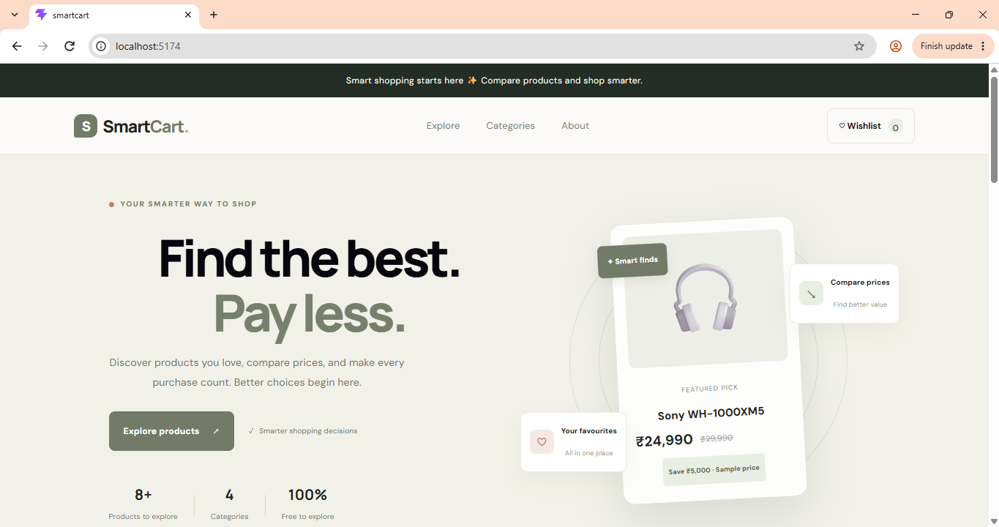
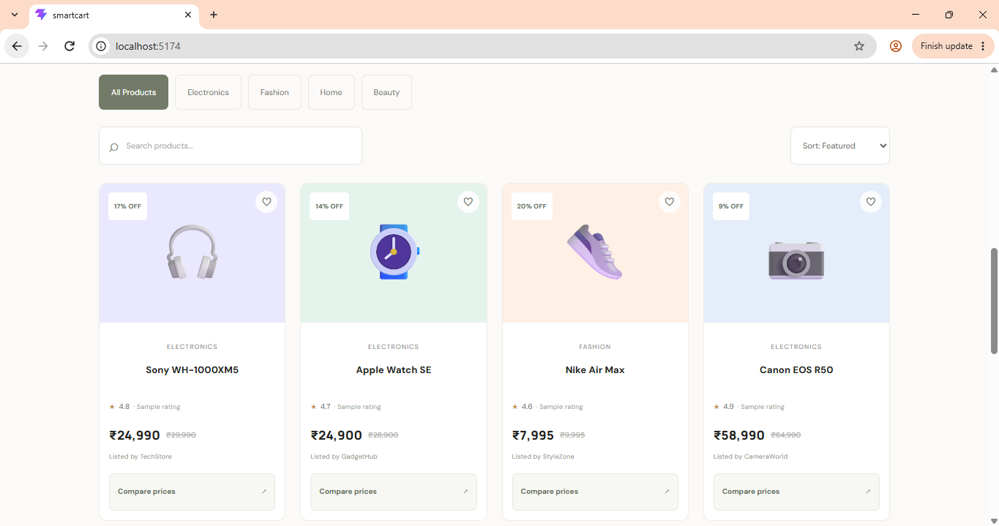
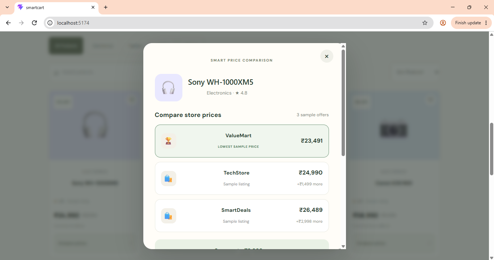

# 🛒 SmartCart – Smart Shopping and Price Comparison Platform

SmartCart is a web application designed to help users explore products, compare prices, save favourite products, and view historical price trends in one place.
## 🖥️ Screenshots

### Homepage


### Products Section


### Product Comparison


- **Product Search:** Find products by name.
- **Category Filtering:** Browse products by category.
- **Sorting:** Organize products based on available sorting options.
- **Product Comparison:** Compare product details in a dedicated comparison view.
- **Wishlist:** Save favourite products and keep them saved across page refreshes.
- **Price History Charts:** Visualize historical price trends using interactive charts.
- **Price Drop Indicator:** Highlight price changes to help users understand price trends.

## 🛠️ Technologies Used

**Frontend**
- React
- JavaScript
- CSS
- Vite
- Recharts

**Backend**
- Python
- Flask
- SQLite
- REST API

## ⚙️ How to Run the Project

### Prerequisites

Install the following:
- Node.js and npm
- Python 3

### 1. Clone the Repository

```bash
git clone https://github.com/husnaabdul/SmartCart.git
cd SmartCart
```

### 2. Set Up the Frontend

Install the dependencies:

```bash
npm install
```

Start the frontend:

```bash
npm run dev
```

Open the local URL displayed in your terminal.

### 3. Set Up the Backend

Open a second terminal from the project folder.

Create a Python virtual environment:

```bash
python -m venv venv
```

Activate it on Windows:

```powershell
.\venv\Scripts\Activate.ps1
```

Install Flask:

```bash
pip install flask
```

Initialize the sample database:

```bash
python backend/init_db.py
```

Start the Flask backend:

```bash
cd backend
python app.py
```

Keep both the frontend and backend running while using the application.

## 📊 Sample Data

SmartCart currently uses demonstration product data and sample price history. The displayed price trends and price-drop indicators are for demonstration purposes and do not represent guaranteed live prices.

## 🎯 Project Objective

The goal of SmartCart is to provide a simple shopping comparison interface while demonstrating frontend development, backend API integration, database management, and interactive data visualization.

## 👩‍💻 Developer

**Husna Abdul Lathif**

GitHub: [husnaabdul](https://github.com/husnaabdul)